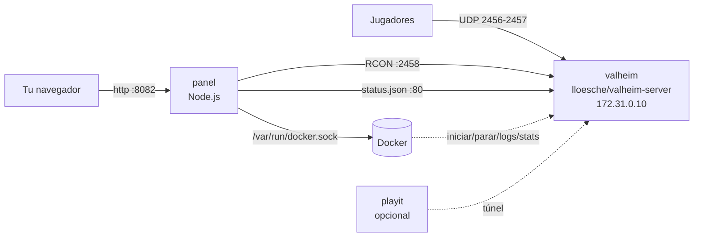

# ⚔️ Servidor de Valheim + Panel web (Docker)

[English](README.md) · **Español**

Monta tu propio **servidor dedicado de Valheim** con Docker y adminístralo desde un **panel web** (ordenador y móvil), sin tocar la consola.
Usa la imagen [`lloesche/valheim-server`](https://github.com/lloesche/valheim-server-docker) y un panel ligero en Node.js (sin dependencias npm) que habla con el servidor a través de Docker y del mod [ValheimRcon](https://thunderstore.io/package/Tristan/ValheimRcon/).

## Índice

- [Funciones](#funciones)
- [Cómo funciona](#cómo-funciona)
- [Requisitos](#requisitos)
- [Puesta en marcha rápida](#puesta-en-marcha-rápida)
- [Qué pasa en el primer arranque](#qué-pasa-en-el-primer-arranque)
- [Referencia de configuración](#referencia-de-configuración)
  - [`.env` (Docker Compose)](#env-docker-compose)
  - [`valheim.env` (servidor del juego)](#valheimenv-servidor-del-juego)
  - [`docker-compose.yml` explicado](#docker-composeyml-explicado)
- [Cómo conectarse al servidor](#cómo-conectarse-al-servidor)
- [Mods](#mods)
- [Copias de seguridad y restaurar](#copias-de-seguridad-y-restaurar)
- [Dónde se guardan los datos](#dónde-se-guardan-los-datos)
- [Comandos del día a día](#comandos-del-día-a-día)
- [Seguridad](#seguridad)
- [Problemas frecuentes](#problemas-frecuentes)
- [Créditos y licencia](#créditos-y-licencia)

## Funciones

| Pestaña | Qué puedes hacer |
| --- | --- |
| 🏠 **Inicio** | Estado, jugadores conectados, tiempo encendido, CPU/RAM, último guardado, gráficas de 24 h, código crossplay, direcciones de conexión, mensaje listo para pasar a tus amigos, iniciar / parar / reiniciar, reiniciar **avisando en el juego** (10, 5, 1 min…), guardar el mundo, copia de seguridad, actividad reciente |
| 👥 **Jugadores** | Tarjetas en vivo (vida, posición, tiempo de sesión): teletransportar, dar objetos o kits, curar, modo inmortal, expulsar/banear. Historial (tiempo jugado, sesiones, muertes), intentos de entrada rechazados, listas de admins / baneados / permitidos |
| 🗺️ **Mapa** | Mapa en vivo con jugadores y lugares guardados; pulsa para teletransportar o marcar un punto en el mapa de todos; enlace al mapa completo de la semilla |
| 🎁 **Objetos** | Kits editables, buscador de ~230 objetos, ver y editar cofres cercanos a un jugador |
| ⚔️ **Mundo** | Progreso de jefes, lanzar/parar asaltos y eventos, aparecer criaturas, limpiar objetos tirados |
| 📢 **Avisos** | Mensaje de bienvenida y mensajes programados |
| ⚙️ **Ajustes** | Nombre, mundo, contraseña, crossplay, lista pública, dificultad (preajustes y modificadores), copias, reinicio diario, actualización automática |
| 🧩 **Mods y copias** | Instalar mods de **Thunderstore** con un clic (con dependencias), subir `.dll`/`.zip`, activar/desactivar, editar `.cfg`, crear / descargar / restaurar / borrar copias, espacio en disco |
| ⌨️ **Consola** | Consola RCON con atajos y registro del servidor con filtro |

Además:

- 🌐 Panel en **español / inglés** (selector en la cabecera; se recuerda en cada navegador).
- 🔐 Acceso con contraseña, sesiones de 30 días y protección contra fuerza bruta.
- 🔁 **Vigilante del crossplay**: si el crossplay pierde la conexión con PlayFab (nadie puede entrar con el código), el panel reinicia el servidor solo cuando no hay nadie conectado (como mucho una vez por hora).
- 🔌 El **mod RCON se instala y configura solo**.
- 🌍 Túnel opcional de [playit.gg](https://playit.gg) para jugar desde fuera sin abrir puertos.

## Cómo funciona



- **valheim**: el servidor del juego. Descarga y actualiza Valheim solo, hace copias de seguridad y carga los mods de BepInEx.
- **panel**: lee el registro del servidor (jugadores, código, guardados…), le pregunta por RCON (jugadores, teletransportes, objetos…), edita `valheim.env` y recrea el servidor con `docker compose` a través del socket de Docker.
- **playit** (opcional, perfil `playit`): túnel para que tus amigos entren sin abrir puertos en el router.

## Requisitos

- **Docker** con **Docker Compose v2** (`docker compose version`).
  - Linux: Docker Engine + plugin compose.
  - Windows: [Docker Desktop](https://www.docker.com/products/docker-desktop/) con WSL 2.
  - macOS: Docker Desktop (Intel o Apple Silicon; en ARM la imagen del juego va emulada y es más lenta).
- **RAM**: mínimo 4 GB libres (8 GB recomendados con mods). **CPU**: 2 núcleos o más. **Disco**: ~3 GB para el juego, más mundos y copias.
- Puertos: **2456-2457/UDP** (juego) y **8082/TCP** (panel, solo en tu red local).
- Git para clonar el repositorio (o descarga el ZIP desde GitHub).

## Puesta en marcha rápida

### Linux / macOS

```bash
git clone https://github.com/barthxc/valheim-server-docker.git
cd valheim-server-docker
./setup.sh                    # crea .env y valheim.env con contraseñas aleatorias
nano valheim.env              # nombre del servidor, mundo, contraseña, crossplay...
docker compose up -d --build
```

### Windows (PowerShell)

```powershell
git clone https://github.com/barthxc/valheim-server-docker.git
cd valheim-server-docker
powershell -ExecutionPolicy Bypass -File .\setup.ps1
notepad valheim.env
docker compose up -d --build
```

Abre **http://localhost:8082** y entra con la **contraseña del panel** que muestra el script (es `PANEL_PASSWORD` en `.env`).

> **Sin el script**: copia `.env.example` → `.env` y `valheim.env.example` → `valheim.env`, y rellena como mínimo `PROJECT_DIR`, `RCON_PASSWORD`, `PANEL_PASSWORD` y `SERVER_PASS`. Mira las tablas de abajo.

## Qué pasa en el primer arranque

1. El contenedor `valheim` descarga el servidor dedicado (~1–2 GB) y BepInEx. Tarda unos minutos; el panel muestra *Descargando/actualizando…*. Puedes seguirlo con `docker compose logs -f valheim`.
2. Mientras tanto, el panel instala el mod **ValheimRcon** desde Thunderstore y crea `data/config/bepinex/org.tristan.rcon.cfg` con tu `RCON_PASSWORD`.
3. Cuando el servidor está en línea y no hay nadie conectado, el panel lo **reinicia una vez** para cargar el mod. A partir de ahí la pestaña Consola muestra *🟢 Conectado al servidor por RCON* y todo funciona.
4. Con `-crossplay` (por defecto) aparece el **código** en 🏠 Inicio. Pásaselo a tus amigos y listo.

## Referencia de configuración

Hay dos archivos de configuración. Los dos se crean a partir de su `*.example` y git los ignora:

| Archivo | Lo usa | Qué contiene |
| --- | --- | --- |
| `.env` | Docker Compose (las variables `${...}` de `docker-compose.yml`) | Rutas, contraseñas del panel y del RCON, direcciones, idioma |
| `valheim.env` | El contenedor `valheim` (`env_file`) | Ajustes del servidor del juego. **La pestaña ⚙️ Ajustes del panel edita este archivo** |

### `.env` (Docker Compose)

| Variable | Obligatoria | Por defecto | Descripción |
| --- | --- | --- | --- |
| `PROJECT_DIR` | ✅ | — | Ruta absoluta de esta carpeta **tal y como la ve Docker**. El panel ejecuta `docker compose` a través del socket de Docker, así que las rutas de los volúmenes tienen que ser las del host. Mira la tabla de abajo. |
| `RCON_PASSWORD` | ✅ | — | Clave compartida entre el panel y el mod ValheimRcon. El panel la escribe en el `.cfg` del mod (y la corrige si no coinciden). Pon una cadena larga y aleatoria; nunca tendrás que escribirla. |
| `PANEL_PASSWORD` | recomendada | *(vacía)* | Contraseña para entrar al panel. Vacía = sin contraseña (solo si nadie más puede llegar al panel). |
| `PANEL_PORT` | | `8082` | Puerto del panel en tu equipo (`http://localhost:8082`). |
| `LOCAL_ADDRESS` | | *(vacía)* | IP de tu PC en la red local + puerto, que el panel muestra a quien juega en casa, p. ej. `192.168.1.50:2456`. También se usa para mostrar la URL del panel para el móvil. |
| `PUBLIC_ADDRESS` | | *(vacía)* | Dirección pública que aparece en el panel y en el mensaje para amigos: tu túnel de playit (`algo.ply.gg:12345`) o `tu-ip-publica:2456` si abres puertos. |
| `TZ` | | `UTC` | Zona horaria del panel ([lista](https://en.wikipedia.org/wiki/List_of_tz_database_time_zones)). Usa la misma que en `valheim.env`. |
| `PANEL_LANG` | | `en` | Idioma de lo que el panel manda **dentro del juego** (avisos de reinicio) y de los nombres de los kits por defecto: `es` o `en`. El idioma de la interfaz se elige en el navegador. |
| `PLAYIT_SECRET_KEY` | | *(vacía)* | Clave secreta de tu agente de playit.gg; solo se usa con el perfil `playit`. |

**`PROJECT_DIR` según tu sistema:**

| Sistema | Carpeta de ejemplo | `PROJECT_DIR` |
| --- | --- | --- |
| Linux | `/home/ana/valheim-server-docker` | `/home/ana/valheim-server-docker` (lo que dice `pwd`) |
| macOS | `/Users/ana/valheim-server-docker` | `/Users/ana/valheim-server-docker` |
| Windows + Docker Desktop | `C:\Users\Ana\valheim-server-docker` | `/run/desktop/mnt/host/c/Users/Ana/valheim-server-docker` (letra de unidad en minúscula y barras `/`) |
| WSL 2 (repo en una unidad de Windows) | `/mnt/d/juegos/valheim-server-docker` | `/run/desktop/mnt/host/d/juegos/valheim-server-docker` |
| WSL 2 (repo dentro de Linux) | `/home/ana/valheim-server-docker` | `/home/ana/valheim-server-docker` |

`setup.sh` y `setup.ps1` lo calculan solos. Si está mal, `docker compose up` falla con errores de montaje, o falla **Guardar y aplicar** en el panel.

### `valheim.env` (servidor del juego)

Todo lo de este archivo se pasa a la imagen [lloesche/valheim-server](https://github.com/lloesche/valheim-server-docker#environment-variables), así que **sirve cualquier variable de esa imagen**. El panel edita estas desde ⚙️ Ajustes (respetando tus comentarios):

| Variable | Valor en el ejemplo | Descripción |
| --- | --- | --- |
| `SERVER_NAME` | `My Valheim Server` | Nombre que aparece en la lista de servidores. |
| `WORLD_NAME` | `Midgard` | Mundo que se carga o se crea (letras, números, `-` y `_`). Si lo cambias se crea un mundo **nuevo**; el anterior se queda en el disco. |
| `SERVER_PASS` | aleatoria | Contraseña del juego: **mínimo 5 caracteres**, y no puede estar dentro de `SERVER_NAME` (regla de Valheim). |
| `SERVER_PUBLIC` | `false` | `true` lo muestra en la lista pública de la comunidad. |
| `SERVER_ARGS` | `-crossplay` | Argumentos de arranque (ver abajo). |
| `BEPINEX` | `true` | Activa los mods de BepInEx. **Déjalo en `true`**: el panel necesita el mod RCON. |
| `STATUS_HTTP` | `true` | Sirve `status.json` dentro de la red de Docker; el panel lo usa para el número de jugadores y la versión. |
| `BACKUPS` | `true` | Copias automáticas del mundo en `data/config/backups`. |
| `BACKUPS_CRON` | `0 */2 * * *` | Cuándo hacer copia ([formato cron](https://crontab.guru)): cada 2 horas. |
| `BACKUPS_MAX_AGE` | `3` | Borra las copias con más de N días. |
| `RESTART_CRON` | `0 5 * * *` | Reinicio diario (cron). Vacío = nunca. |
| `UPDATE_IF_IDLE` | `true` | Instala actualizaciones de Valheim solo cuando no hay nadie. |
| `TZ` | `Europe/Madrid` | Zona horaria del servidor (horas del registro y del cron). |

**`SERVER_ARGS`**: combina los que quieras separados por espacios (el panel escribe esta línea por ti):

| Argumento | Valores | Efecto |
| --- | --- | --- |
| `-crossplay` | — | Código de unión y jugadores de Xbox / PC Game Pass. Quien entre con el código no necesita puertos abiertos. |
| `-preset <nombre>` | `normal` `casual` `easy` `hard` `hardcore` `immersive` `hammer` | Preajuste de dificultad del mundo. |
| `-modifier combat <v>` | `veryeasy` `easy` `hard` `veryhard` | Dificultad de los enemigos. |
| `-modifier deathpenalty <v>` | `casual` `veryeasy` `easy` `hard` `hardcore` | Lo que pierdes al morir. |
| `-modifier resources <v>` | `muchless` `less` `more` `muchmore` `most` | Cantidad de recursos que sueltan las cosas. |
| `-modifier raids <v>` | `none` `muchless` `less` `more` `muchmore` | Frecuencia de los asaltos. |
| `-modifier portals <v>` | `casual` `hard` `veryhard` | `casual`: todo pasa por los portales; `hard`: sin minerales…; `veryhard`: sin portales. |
| `-setkey <clave>` | `nobuildcost` `playerevents` `passivemobs` `nomap` | Construir gratis, asaltos según cada jugador, enemigos pasivos, sin mapa. |

Ejemplo: `SERVER_ARGS=-crossplay -preset hard -modifier portals casual -setkey nomap`

Otras variables útiles de la imagen (comentadas en `valheim.env.example`): `UPDATE_CRON`, `RESTART_IF_IDLE`, `BACKUPS_IF_IDLE`, `BACKUPS_DIRECTORY`, `PUID`/`PGID`. Lista completa en [lloesche/valheim-server-docker](https://github.com/lloesche/valheim-server-docker#environment-variables).

### `docker-compose.yml` explicado

**`valheim`**: el servidor del juego

| Ajuste | Para qué |
| --- | --- |
| `image: ghcr.io/lloesche/valheim-server` | Descarga y actualiza Valheim, copias, BepInEx, página de estado. |
| `env_file: valheim.env` | Ajustes del juego (ver arriba). |
| `ports: 2456-2457:2456-2457/udp` | Puertos del juego. Ábrelos en el router solo si juegas por Internet **sin** crossplay ni playit. |
| `volumes: data/config → /config` | Mundos, copias, listas de admins/baneados/permitidos, mods de BepInEx y sus `.cfg`, datos del panel. |
| `volumes: data/opt → /opt/valheim` | Archivos del servidor descargados (se conservan para que las actualizaciones sean rápidas). |
| `networks.vhnet.ipv4_address: 172.31.0.10` | IP fija para que el panel siempre encuentre el RCON (`2458`) y `status.json`. |
| `stop_grace_period: 2m` | Da tiempo a guardar el mundo antes de que Docker pare el contenedor a la fuerza. |
| `logging: max-size 20m, max-file 3` | El registro nunca pasa de 60 MB. |
| `restart: unless-stopped` | Arranca solo con Docker, salvo que lo hayas parado tú. |

**`panel`**: el panel web (se construye desde `./panel`)

| Ajuste | Para qué |
| --- | --- |
| `ports: ${PANEL_PORT}:3000` | Dirección del panel. Accesible desde tu red local (móvil, portátil). |
| `environment` | `LOCAL_ADDRESS`, `PUBLIC_ADDRESS`, `TZ`, `PANEL_LANG`, `RCON_*`, `PANEL_PASSWORD` (ver `.env`). `RCON_HOST`/`RCON_PORT` apuntan al contenedor del juego y normalmente no se tocan. |
| `/var/run/docker.sock` | Iniciar/parar/reiniciar el servidor y leer su registro y su consumo de CPU/RAM. |
| `${PROJECT_DIR} → /project` | Editar `valheim.env` y recrear el servidor con `docker compose up -d valheim` (**Guardar y aplicar**). |
| `data/config → /config` | Los mismos datos que el servidor: mundos, mods, copias, listas. |

**`playit`**: túnel opcional; solo arranca con `--profile playit`. Usa `PLAYIT_SECRET_KEY`.

**`networks.vhnet`**: red privada `172.31.0.0/24`. Si choca con alguna red que ya tengas, cambia la subred y las dos IPs fijas (`172.31.0.10` aquí y `RCON_HOST`), y añade `RCON_WHITELIST` al panel (p. ej. `RCON_WHITELIST: 10.50.0.0/24`).

## Cómo conectarse al servidor

| Forma | Cuándo | Cómo |
| --- | --- | --- |
| **Código crossplay** | Por defecto (`-crossplay`). Desde cualquier sitio, PC y Xbox | Valheim → *Unirse a partida* → *Añadir servidor* → escribe el código de 🏠 Inicio. Puede cambiar al reiniciar; el panel siempre muestra el actual. |
| **Misma Wi-Fi / LAN** | Sin crossplay | *Unirse a partida* → *Añadir servidor* → `LOCAL_ADDRESS` (p. ej. `192.168.1.50:2456`). Con crossplay activado la IP local no funciona: usa el código o la IP pública que muestra el panel. |
| **Abrir puertos** | Sin crossplay, desde Internet | Redirige **UDP 2456-2457** en el router hacia tu PC, permítelos en el cortafuegos y comparte `tu-ip-publica:2456`. |
| **Túnel playit.gg** | Sin crossplay y sin tocar el router | Mira abajo. |

### playit.gg (opcional)

1. Crea una cuenta gratis en [playit.gg](https://playit.gg) → **Agents** → *Add agent* → *Docker* y copia la **secret key**.
2. Ponla en `.env` (`PLAYIT_SECRET_KEY=...`) y arráncalo: `docker compose --profile playit up -d`.
3. En el panel de playit, crea un túnel **UDP** (o el preset *Valheim* si aparece) de **2 puertos** con dirección local **`172.31.0.10`** y puerto local **`2456`**.
4. Copia la dirección que te da playit en `PUBLIC_ADDRESS` de `.env` y ejecuta `docker compose up -d panel` para que el panel la muestre.

### Administradores

Añade tu **SteamID64** (17 cifras; búscalo en [steamid.io](https://steamid.io)) en 👥 Jugadores → *Administradores* y reinicia el servidor. Los admins pueden abrir la consola del juego (F5) y usar `kick`, `ban`, `save`…

## Mods

- 🧩 **Mods y copias** → *Buscar mods en Thunderstore* → **Instalar**. Las dependencias se instalan solas. También puedes subir un `.dll` o un `.zip`.
- Los cambios se aplican **al reiniciar** (el panel muestra un aviso con el botón *Reiniciar ahora*).
- La mayoría de mods tienen que **instalarlos también todos los jugadores** (con [r2modman](https://thunderstore.io/package/ebkr/r2modman/) o Thunderstore Mod Manager). Los marcados como *Server-side* solo hacen falta en el servidor. El «mensaje para tus amigos» de 🏠 Inicio incluye la lista de mods que necesitan.
- Configuración de los mods: *Configuración de mods (.cfg)* en la misma pestaña (los archivos aparecen cuando el servidor ha arrancado una vez con el mod).
- Los archivos están en `data/config/bepinex/plugins` (los desactivados, en `plugins_disabled`).

## Copias de seguridad y restaurar

- Las copias automáticas siguen `BACKUPS_CRON` / `BACKUPS_MAX_AGE` y se guardan en `data/config/backups/worlds-AAAAMMDD-HHMMSS.zip`.
- **Hacer copia ahora**, **Descargar**, **Restaurar** y **Borrar** en 🧩 Mods y copias.
- **Restaurar** para el servidor, renombra la carpeta del mundo actual a `worlds_local.antes-de-restaurar-<fecha>` (no se pierde nada) y arranca con la copia elegida.
- Valheim solo guarda el mundo cada 30 minutos y al apagarse: pulsa *Guardar mundo ahora* antes de una copia manual.
- **Traer un mundo que ya tienes**: para el servidor, copia los archivos de tu mundo (en Windows están en `%USERPROFILE%\AppData\LocalLow\IronGate\Valheim\worlds_local`, o cópialos de otro servidor) a `data/config/worlds_local/`, pon su nombre en `WORLD_NAME` y vuelve a arrancar.

## Dónde se guardan los datos

```text
data/
├── config/                    → /config en los dos contenedores
│   ├── worlds_local/          tus mundos
│   ├── backups/               copias de seguridad (.zip)
│   ├── adminlist.txt          administradores (SteamID64)
│   ├── bannedlist.txt         baneados
│   ├── permittedlist.txt      si no está vacía, SOLO pueden entrar estos jugadores
│   ├── bepinex/
│   │   ├── plugins/           mods instalados
│   │   ├── plugins_disabled/  mods desactivados
│   │   └── *.cfg              configuración de los mods (incluido org.tristan.rcon.cfg)
│   └── panel/                 datos del panel: ajustes, kits, lugares, estadísticas, historial de 24 h, sesiones
└── opt/                       → /opt/valheim, el servidor del juego descargado
```

Para llevarte el servidor a otro equipo: copia la carpeta entera (con `data/`, `.env` y `valheim.env`), corrige `PROJECT_DIR` y ejecuta `docker compose up -d --build`.

## Comandos del día a día

```bash
docker compose up -d --build          # arrancar todo (o aplicar cambios de docker-compose.yml/.env)
docker compose ps                     # estado
docker compose logs -f valheim        # registro del servidor del juego
docker compose logs -f panel          # registro del panel
docker compose restart valheim        # reiniciar el servidor (guarda el mundo antes)
docker compose stop                   # parar todo (se guarda el mundo)
docker compose down                   # parar y borrar los contenedores (data/ se conserva)

# Actualizar el panel después de "git pull"
git pull && docker compose up -d --build panel
# Actualizar la imagen del servidor (Valheim se actualiza solo)
docker compose pull valheim && docker compose up -d valheim
```

## Seguridad

- El panel tiene acceso al **socket de Docker**, que equivale a ser root en el equipo. **No abras nunca el puerto 8082 a Internet** (no lo redirijas en el router). Para entrar desde fuera usa una VPN como [Tailscale](https://tailscale.com) o WireGuard.
- Pon siempre `PANEL_PASSWORD`. Se permiten 5 intentos fallidos por minuto e IP, y las sesiones duran 30 días.
- El RCON (puerto 2458) **no se publica**: solo es accesible dentro de la red de Docker, y la lista blanca del mod solo admite esa red.
- `.env`, `valheim.env` y `data/` están en `.gitignore`. No los subas a ningún sitio: tienen tus contraseñas.

## Problemas frecuentes

<details>
<summary><b>El panel dice «RCON no disponible»</b></summary>

El servidor aún está arrancando (el primer arranque tarda minutos) o el mod RCON todavía no se ha cargado. Espera al reinicio automático o pulsa *Reiniciar ahora*. Mira `docker compose logs panel` por si aparece «No se pudo preparar el mod RCON» (por ejemplo, sin Internet para llegar a Thunderstore) y comprueba que `BEPINEX=true` en `valheim.env`. Si cambiaste `RCON_PASSWORD`, ejecuta `docker compose up -d panel`: el panel actualiza el `.cfg` del mod y reinicia el servidor cuando no hay nadie.
</details>

<details>
<summary><b>Falla «Guardar y aplicar» o hay errores de montaje</b></summary>

`PROJECT_DIR` está mal. Tiene que ser la ruta de esta carpeta tal y como la ve Docker (mira la tabla de [`.env`](#env-docker-compose)). Después de corregirlo: `docker compose up -d --build`.
</details>

<details>
<summary><b>Mis amigos no pueden entrar con el código crossplay</b></summary>

A veces PlayFab pierde la conexión: el panel muestra un aviso naranja y reinicia solo cuando no hay nadie (⚙️ Ajustes → opciones del panel). También puedes pulsar *Reiniciar ahora*. Comprueba que todos tenéis la misma versión del juego y los mismos mods.
</details>

<details>
<summary><b>Rechaza a quien intenta entrar</b></summary>

👥 Jugadores → *Intentos de entrada rechazados* muestra el motivo: contraseña incorrecta, baneado, no está en la lista de permitidos (si `permittedlist.txt` tiene a alguien, solo pueden entrar esos jugadores) o versión/mods distintos.
</details>

<details>
<summary><b>El puerto 8082 o la red 172.31.0.0/24 ya están en uso</b></summary>

Cambia `PANEL_PORT` en `.env`. Para la red, mira [`docker-compose.yml` explicado](#docker-composeyml-explicado).
</details>

<details>
<summary><b>¿Cómo cambio el idioma del panel?</b></summary>

Con el selector 🌐 ES/EN de la cabecera (o de la pantalla de acceso). Se guarda en cada navegador. Los mensajes dentro del juego usan `PANEL_LANG`.
</details>

## Créditos y licencia

- Imagen del servidor: [lloesche/valheim-server-docker](https://github.com/lloesche/valheim-server-docker)
- Mod RCON: [ValheimRcon](https://thunderstore.io/package/Tristan/ValheimRcon/) de Tristan ([comandos](https://github.com/Tristan-dvr/ValheimRcon/blob/master/commands.md))
- Catálogo de mods: [Thunderstore](https://thunderstore.io/c/valheim/) · Túnel: [playit.gg](https://playit.gg) · Mapa de semillas: [valheim-map.world](https://valheim-map.world)
- Valheim es una marca de Iron Gate AB. Este proyecto no está afiliado a Iron Gate ni a Coffee Stain.

Publicado bajo la [licencia MIT](LICENSE).
