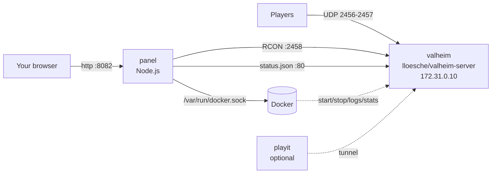

# ⚔️ Valheim Server + Web Panel (Docker)

**English** · [Español](README.es.md)

Run your own **Valheim dedicated server** with Docker and manage it from a **web panel** (desktop and mobile) — no console needed.
Based on the excellent [`lloesche/valheim-server`](https://github.com/lloesche/valheim-server-docker) image, plus a lightweight Node.js panel (no npm dependencies) that talks to the server through Docker and the [ValheimRcon](https://thunderstore.io/package/Tristan/ValheimRcon/) mod.

## Contents

- [Features](#features)
- [How it works](#how-it-works)
- [Requirements](#requirements)
- [Quick start](#quick-start)
- [What happens on the first start](#what-happens-on-the-first-start)
- [Configuration reference](#configuration-reference)
  - [`.env` (Docker Compose)](#env-docker-compose)
  - [`valheim.env` (game server)](#valheimenv-game-server)
  - [`docker-compose.yml` explained](#docker-composeyml-explained)
- [Connecting to the server](#connecting-to-the-server)
- [Mods](#mods)
- [Backups and restoring](#backups-and-restoring)
- [Where the data lives](#where-the-data-lives)
- [Everyday commands](#everyday-commands)
- [Security](#security)
- [Troubleshooting / FAQ](#troubleshooting--faq)
- [Credits and license](#credits-and-license)

## Features

| Tab | What you can do |
| --- | --- |
| 🏠 **Home** | Status, players online, uptime, CPU/RAM, last save, 24 h charts, crossplay join code, connection addresses, a ready-to-paste message for your friends, start / stop / restart, restart **with in-game warning** (10, 5, 1 min…), save world, backup now, recent activity feed |
| 👥 **Players** | Live player cards (health, position, session time): teleport, give items or kits, heal, immortal mode, kick/ban. Player history (time played, sessions, deaths), rejected join attempts, admin / ban / allow lists |
| 🗺️ **Map** | Live map with players and saved places, click to teleport or ping a point on everyone's map, link to the full seed map |
| 🎁 **Items** | Editable kits, search ~230 items, view and edit chests near a player |
| ⚔️ **World** | Boss progress (global keys), start/stop raids and events, spawn creatures, clean up dropped items |
| 📢 **Messages** | Welcome message and scheduled broadcasts |
| ⚙️ **Settings** | Server name, world, password, crossplay, public listing, difficulty presets and modifiers, backups, daily restart, auto-update |
| 🧩 **Mods & backups** | Install mods from **Thunderstore** with one click (dependencies included), upload `.dll`/`.zip`, enable/disable, edit `.cfg` files, create / download / restore / delete backups, disk usage |
| ⌨️ **Console** | RCON console with shortcuts, filtered server log |

Also included:

- 🌐 **Spanish / English** panel (selector in the header, remembered per browser).
- 🔐 Panel login with a password, 30-day sessions and brute-force protection.
- 🔁 **Crossplay watchdog**: if crossplay loses its connection to PlayFab (nobody can join with the code), the panel restarts the server automatically when nobody is online (at most once per hour).
- 🔌 The **RCON mod is installed and configured automatically**.
- 🌍 Optional [playit.gg](https://playit.gg) tunnel to play from outside without opening ports.

## How it works



- **valheim**: the game server. It downloads and updates Valheim by itself, makes backups and loads BepInEx mods.
- **panel**: reads the server log (players, join code, saves…), asks the server via RCON (players, teleport, give, …), edits `valheim.env` and re-creates the server with `docker compose` through the Docker socket.
- **playit** (optional, profile `playit`): a tunnel so friends can connect without port forwarding.

## Requirements

- **Docker** with **Docker Compose v2** (`docker compose version`).
  - Linux: Docker Engine + compose plugin.
  - Windows: [Docker Desktop](https://www.docker.com/products/docker-desktop/) with the WSL 2 backend.
  - macOS: Docker Desktop (Intel or Apple Silicon; the game image runs emulated on ARM and is slower).
- **RAM**: 4 GB free minimum (8 GB recommended with mods). **CPU**: 2+ cores. **Disk**: ~3 GB for the game + worlds and backups.
- Ports: **2456-2457/UDP** (game) and **8082/TCP** (panel, local network only).
- Git (to clone the repo) — or download the ZIP from GitHub.

## Quick start

### Linux / macOS

```bash
git clone https://github.com/barthxc/valheim-server-docker.git
cd valheim-server-docker
./setup.sh                    # creates .env and valheim.env with random passwords
nano valheim.env              # server name, world, password, crossplay...
docker compose up -d --build
```

### Windows (PowerShell)

```powershell
git clone https://github.com/barthxc/valheim-server-docker.git
cd valheim-server-docker
powershell -ExecutionPolicy Bypass -File .\setup.ps1
notepad valheim.env
docker compose up -d --build
```

Then open **http://localhost:8082** and log in with the **panel password** printed by the setup script (it is `PANEL_PASSWORD` in `.env`).

> **Manual setup instead of the script**: copy `.env.example` → `.env` and `valheim.env.example` → `valheim.env`, then fill in at least `PROJECT_DIR`, `RCON_PASSWORD`, `PANEL_PASSWORD` and `SERVER_PASS`. See the tables below.

## What happens on the first start

1. The `valheim` container downloads the Valheim dedicated server (~1–2 GB) and BepInEx. This takes a few minutes; the panel shows *Downloading/updating…*. Follow it with `docker compose logs -f valheim`.
2. Meanwhile the panel installs the **ValheimRcon** mod from Thunderstore and writes `data/config/bepinex/org.tristan.rcon.cfg` with your `RCON_PASSWORD`.
3. When the server is online and nobody is connected, the panel **restarts it once** so the mod loads. After that the Console tab shows *🟢 Connected to the server via RCON* and every feature is available.
4. With `-crossplay` (default), the **join code** appears on the Home tab. Share it with your friends — done!

## Configuration reference

There are two configuration files, both created from their `*.example` and both ignored by git:

| File | Used by | What it contains |
| --- | --- | --- |
| `.env` | Docker Compose (variables `${...}` in `docker-compose.yml`) | Paths, panel and RCON passwords, addresses, language |
| `valheim.env` | The `valheim` container (`env_file`) | Game server settings. **The panel's ⚙️ Settings tab edits this file** |

### `.env` (Docker Compose)

| Variable | Required | Default | Description |
| --- | --- | --- | --- |
| `PROJECT_DIR` | ✅ | — | Absolute path of this folder **as the Docker daemon sees it**. The panel runs `docker compose` through the Docker socket, so the volume paths must be host paths. See below. |
| `RCON_PASSWORD` | ✅ | — | Shared secret between the panel and the ValheimRcon mod. The panel writes it into the mod's `.cfg` (and fixes it if they differ). Use a long random string; you never type it. |
| `PANEL_PASSWORD` | recommended | *(empty)* | Password to log into the panel. Empty disables the login — only acceptable if nobody else can reach the panel. |
| `PANEL_PORT` | | `8082` | Host port of the panel (`http://localhost:8082`). |
| `LOCAL_ADDRESS` | | *(empty)* | Your PC's LAN IP + game port, shown in the panel for players at home, e.g. `192.168.1.50:2456`. Also used to show the panel URL for your phone. |
| `PUBLIC_ADDRESS` | | *(empty)* | Public address shown in the panel and in the friends message: your playit tunnel (`something.ply.gg:12345`) or `your-public-ip:2456` if you forward ports. |
| `TZ` | | `UTC` | Panel time zone ([list](https://en.wikipedia.org/wiki/List_of_tz_database_time_zones)). Use the same as in `valheim.env`. |
| `PANEL_LANG` | | `en` | Language of what the panel sends **into the game** (restart warnings) and of the default kit names: `es` or `en`. The UI language is chosen in the browser. |
| `PLAYIT_SECRET_KEY` | | *(empty)* | Secret key of your playit.gg agent, only used with the `playit` profile. |

**`PROJECT_DIR` by system:**

| System | Example folder | `PROJECT_DIR` |
| --- | --- | --- |
| Linux | `/home/ana/valheim-server-docker` | `/home/ana/valheim-server-docker` (output of `pwd`) |
| macOS | `/Users/ana/valheim-server-docker` | `/Users/ana/valheim-server-docker` |
| Windows + Docker Desktop | `C:\Users\Ana\valheim-server-docker` | `/run/desktop/mnt/host/c/Users/Ana/valheim-server-docker` (drive letter in lowercase, forward slashes) |
| WSL 2 (repo on a Windows drive) | `/mnt/d/games/valheim-server-docker` | `/run/desktop/mnt/host/d/games/valheim-server-docker` |
| WSL 2 (repo inside the Linux home) | `/home/ana/valheim-server-docker` | `/home/ana/valheim-server-docker` |

`setup.sh` / `setup.ps1` detect it for you. If it is wrong, `docker compose up` fails with mount errors, or **Save and apply** in the panel fails.

### `valheim.env` (game server)

Everything in this file is passed to the [lloesche/valheim-server](https://github.com/lloesche/valheim-server-docker#environment-variables) image, so **any variable of that image works here**. The panel edits these keys from ⚙️ Settings (keeping your comments):

| Variable | Default in example | Description |
| --- | --- | --- |
| `SERVER_NAME` | `My Valheim Server` | Name shown in the server list. |
| `WORLD_NAME` | `Midgard` | World to load/create (letters, numbers, `-`, `_`). Changing it creates a **new** world; the old one stays on disk. |
| `SERVER_PASS` | random | Game password: **at least 5 characters**, and it cannot be contained in `SERVER_NAME` (Valheim rule). |
| `SERVER_PUBLIC` | `false` | `true` lists the server in the public community list. |
| `SERVER_ARGS` | `-crossplay` | Extra launch arguments (see below). |
| `BEPINEX` | `true` | Enables BepInEx mods. **Keep it `true`**: the panel needs the RCON mod. |
| `STATUS_HTTP` | `true` | Serves `status.json` inside the Docker network; the panel uses it for player count/version. |
| `BACKUPS` | `true` | Automatic world backups to `data/config/backups`. |
| `BACKUPS_CRON` | `0 */2 * * *` | When to back up ([cron format](https://crontab.guru)). Every 2 hours. |
| `BACKUPS_MAX_AGE` | `3` | Delete backups older than N days. |
| `RESTART_CRON` | `0 5 * * *` | Daily restart (cron). Empty = never. |
| `UPDATE_IF_IDLE` | `true` | Install Valheim updates only when nobody is online. |
| `TZ` | `Europe/Madrid` | Server time zone (log timestamps and cron schedules). |

**`SERVER_ARGS`** — combine as many as you want, separated by spaces (the panel builds this line for you):

| Argument | Values | Effect |
| --- | --- | --- |
| `-crossplay` | — | Join code + Xbox / PC Game Pass players. No port forwarding needed for players using the code. |
| `-preset <name>` | `normal` `casual` `easy` `hard` `hardcore` `immersive` `hammer` | World difficulty preset. |
| `-modifier combat <v>` | `veryeasy` `easy` `hard` `veryhard` | Enemy difficulty. |
| `-modifier deathpenalty <v>` | `casual` `veryeasy` `easy` `hard` `hardcore` | What you lose when you die. |
| `-modifier resources <v>` | `muchless` `less` `more` `muchmore` `most` | Resource drop rate. |
| `-modifier raids <v>` | `none` `muchless` `less` `more` `muchmore` | Raid frequency. |
| `-modifier portals <v>` | `casual` `hard` `veryhard` | `casual`: everything can go through portals; `hard`: no ores…; `veryhard`: no portals. |
| `-setkey <key>` | `nobuildcost` `playerevents` `passivemobs` `nomap` | Free building, raids based on each player, passive enemies, no map. |

Example: `SERVER_ARGS=-crossplay -preset hard -modifier portals casual -setkey nomap`

Other useful image variables (commented in `valheim.env.example`): `UPDATE_CRON`, `RESTART_IF_IDLE`, `BACKUPS_IF_IDLE`, `BACKUPS_DIRECTORY`, `PUID`/`PGID`. Full list: [lloesche/valheim-server-docker](https://github.com/lloesche/valheim-server-docker#environment-variables).

### `docker-compose.yml` explained

**`valheim`** — the game server

| Setting | Why |
| --- | --- |
| `image: ghcr.io/lloesche/valheim-server` | Downloads/updates Valheim, backups, BepInEx, status page. |
| `env_file: valheim.env` | Game settings (see above). |
| `ports: 2456-2457:2456-2457/udp` | Game ports. Forward them on your router only if you play over the Internet **without** crossplay or playit. |
| `volumes: data/config → /config` | Worlds, backups, admin/ban/allow lists, BepInEx plugins and `.cfg` files, panel state. |
| `volumes: data/opt → /opt/valheim` | Downloaded server files (kept between restarts so updates are fast). |
| `networks.vhnet.ipv4_address: 172.31.0.10` | Fixed IP so the panel can always reach RCON (`2458`) and `status.json`. |
| `stop_grace_period: 2m` | Gives the server time to save the world before Docker kills it. |
| `logging: max-size 20m, max-file 3` | The log never grows beyond 60 MB. |
| `restart: unless-stopped` | Starts again with Docker unless you stopped it yourself. |

**`panel`** — the web panel (built from `./panel`)

| Setting | Why |
| --- | --- |
| `ports: ${PANEL_PORT}:3000` | Panel URL. Reachable from your LAN (phone, laptop). |
| `environment` | `LOCAL_ADDRESS`, `PUBLIC_ADDRESS`, `TZ`, `PANEL_LANG`, `RCON_*`, `PANEL_PASSWORD` (see `.env`). `RCON_HOST`/`RCON_PORT` point to the game container and normally never change. |
| `/var/run/docker.sock` | Start/stop/restart the server, read its log and CPU/RAM stats. |
| `${PROJECT_DIR} → /project` | Edit `valheim.env` and re-create the server with `docker compose up -d valheim` (**Save and apply**). |
| `data/config → /config` | Same data as the server: worlds, mods, backups, lists. |

**`playit`** — optional tunnel, only started with `--profile playit`. Uses `PLAYIT_SECRET_KEY`.

**`networks.vhnet`** — private network `172.31.0.0/24`. If it clashes with a network you already have, change the subnet, the two fixed IPs (`172.31.0.10` here and `RCON_HOST`), and set `RCON_WHITELIST` for the panel (e.g. `RCON_WHITELIST: 10.50.0.0/24`).

## Connecting to the server

| Method | When | How |
| --- | --- | --- |
| **Crossplay join code** | Default (`-crossplay`). Works from anywhere, PC and Xbox | Valheim → *Join game* → *Add server* → type the code shown on 🏠 Home. The code can change after a restart; the panel always shows the current one. |
| **Same Wi-Fi / LAN** | Without crossplay | *Join game* → *Add server* → `LOCAL_ADDRESS` (e.g. `192.168.1.50:2456`). With crossplay enabled, the LAN IP does not work; use the code or the public IP shown in the panel. |
| **Port forwarding** | Without crossplay, from the Internet | Forward **UDP 2456-2457** on your router to your PC, allow them in the firewall, and share `your-public-ip:2456`. |
| **playit.gg tunnel** | Without crossplay and without touching the router | See below. |

### playit.gg (optional)

1. Create a free account on [playit.gg](https://playit.gg) → **Agents** → *Add agent* → *Docker* and copy the **secret key**.
2. Put it in `.env`: `PLAYIT_SECRET_KEY=...` and start it: `docker compose --profile playit up -d`.
3. In the playit dashboard, add a **UDP** tunnel (or the *Valheim* preset if it is offered) for **2 ports** whose local address is **`172.31.0.10`**, local port **`2456`**.
4. Copy the address playit gives you into `PUBLIC_ADDRESS` in `.env` and run `docker compose up -d panel` so the panel shows it.

### Admins

Add your **SteamID64** (17 digits, find it on [steamid.io](https://steamid.io)) in 👥 Players → *Admins*, then restart the server. Admins can open the in-game console (F5) and use `kick`, `ban`, `save`…

## Mods

- 🧩 **Mods & backups** → *Search mods on Thunderstore* → **Install**. Dependencies are installed too. Or upload a `.dll` / `.zip`.
- Changes are applied **on the next restart** (the panel shows a banner with a *Restart now* button).
- Most mods must **also be installed by every player** (with [r2modman](https://thunderstore.io/package/ebkr/r2modman/) or Thunderstore Mod Manager). Mods tagged *Server-side* are only needed on the server. The "message for your friends" on 🏠 Home lists the mods they need.
- Mod settings: *Mod configuration (.cfg)* in the same tab (files appear after the server starts once with the mod).
- Files live in `data/config/bepinex/plugins` (disabled ones in `plugins_disabled`).

## Backups and restoring

- Automatic backups follow `BACKUPS_CRON` / `BACKUPS_MAX_AGE` and are stored in `data/config/backups/worlds-YYYYMMDD-HHMMSS.zip`.
- **Backup now**, **Download**, **Restore** and **Delete** from 🧩 Mods & backups.
- **Restore** stops the server, renames the current world folder to `worlds_local.antes-de-restaurar-<date>` (nothing is lost) and starts with the selected backup.
- Valheim itself only saves the world every 30 minutes and on shutdown; use *Save world now* before a manual backup.
- **Bring an existing world**: stop the server, copy your world files (from `%USERPROFILE%\AppData\LocalLow\IronGate\Valheim\worlds_local` on Windows, or from another server) into `data/config/worlds_local/`, set `WORLD_NAME` to its name and start again.

## Where the data lives

```text
data/
├── config/                    → /config in both containers
│   ├── worlds_local/          your worlds
│   ├── backups/               backup .zip files
│   ├── adminlist.txt          admins (SteamID64)
│   ├── bannedlist.txt         banned players
│   ├── permittedlist.txt      if not empty, ONLY these players can join
│   ├── bepinex/
│   │   ├── plugins/           installed mods
│   │   ├── plugins_disabled/  disabled mods
│   │   └── *.cfg              mod settings (incl. org.tristan.rcon.cfg)
│   └── panel/                 panel state: settings, kits, places, player stats, 24 h history, sessions
└── opt/                       → /opt/valheim, the downloaded game server
```

To move the server to another machine: copy the whole folder (with `data/`, `.env` and `valheim.env`), fix `PROJECT_DIR` and run `docker compose up -d --build`.

## Everyday commands

```bash
docker compose up -d --build          # start everything (or apply changes to docker-compose.yml/.env)
docker compose ps                     # status
docker compose logs -f valheim        # game server log
docker compose logs -f panel          # panel log
docker compose restart valheim        # restart the game server (saves the world first)
docker compose stop                   # stop everything (world is saved)
docker compose down                   # stop and remove containers (data/ is kept)

# Update the panel after "git pull"
git pull && docker compose up -d --build panel
# Update the game server image (Valheim itself updates automatically)
docker compose pull valheim && docker compose up -d valheim
```

## Security

- The panel has access to the **Docker socket**, which is equivalent to root on the host. **Never expose port 8082 to the Internet** (no port forwarding for it). For remote access use a VPN such as [Tailscale](https://tailscale.com) or WireGuard.
- Always set `PANEL_PASSWORD`. Logins are limited to 5 failed attempts per minute per IP; sessions last 30 days.
- RCON (port 2458) is **not published**: it is only reachable inside the Docker network, and the mod's IP whitelist only accepts that network.
- `.env`, `valheim.env` and `data/` are in `.gitignore`. Do not commit them: they contain your passwords.

## Troubleshooting / FAQ

<details>
<summary><b>The panel says "RCON unavailable"</b></summary>

The server is still starting (first start takes minutes), or the RCON mod is not loaded yet. Wait for the automatic restart, or click *Restart now*. Check `docker compose logs panel` for "No se pudo preparar el mod RCON" (e.g. no Internet to reach Thunderstore), and that `BEPINEX=true` in `valheim.env`. If you changed `RCON_PASSWORD`, run `docker compose up -d panel`: the panel updates the mod's `.cfg` and restarts the server when it is empty.
</details>

<details>
<summary><b>"Save and apply" fails / mount errors</b></summary>

`PROJECT_DIR` is wrong. It must be the path of this folder as Docker sees it (see the table in [`.env`](#env-docker-compose)). After fixing it: `docker compose up -d --build`.
</details>

<details>
<summary><b>Friends cannot join with the crossplay code</b></summary>

Sometimes PlayFab drops the connection; the panel shows an orange banner and restarts automatically when nobody is online (⚙️ Settings → panel options). You can also click *Restart now*. Check that everybody runs the same game version and the same mods.
</details>

<details>
<summary><b>Join attempts are rejected</b></summary>

👥 Players → *Rejected join attempts* shows the reason: wrong password, banned, not on the allowed list (if `permittedlist.txt` has someone, only those players can join), or different version/mods.
</details>

<details>
<summary><b>Port 8082 or the 172.31.0.0/24 network are already in use</b></summary>

Change `PANEL_PORT` in `.env`. For the network, see [`docker-compose.yml` explained](#docker-composeyml-explained).
</details>

<details>
<summary><b>How do I change the panel language?</b></summary>

Use the 🌐 ES/EN selector in the header (or on the login screen). It is stored per browser. In-game messages use `PANEL_LANG`.
</details>

## Credits and license

- Game server image: [lloesche/valheim-server-docker](https://github.com/lloesche/valheim-server-docker)
- RCON mod: [ValheimRcon](https://thunderstore.io/package/Tristan/ValheimRcon/) by Tristan ([commands](https://github.com/Tristan-dvr/ValheimRcon/blob/master/commands.md))
- Mods catalog: [Thunderstore](https://thunderstore.io/c/valheim/) · Tunnel: [playit.gg](https://playit.gg) · Seed map: [valheim-map.world](https://valheim-map.world)
- Valheim is a trademark of Iron Gate AB. This project is not affiliated with Iron Gate or Coffee Stain.

Released under the [MIT License](LICENSE).
